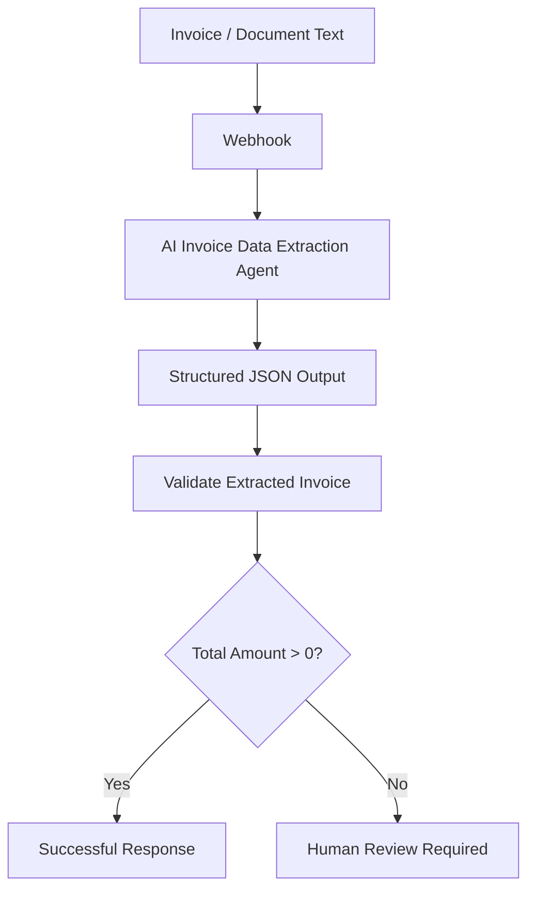
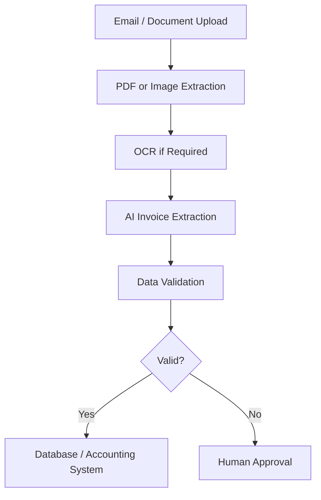

# AI Invoice & Document Data Extractor

An AI-powered document data extraction and validation workflow built with **n8n, AI Agents, and structured JSON output**.

The workflow receives invoice or document text through a webhook, extracts key information using an AI Agent, validates the extracted total amount, and routes incomplete records for human review.

**Project Status:** Complete · Portfolio Version Frozen  
**Platform:** n8n  
**AI Model:** OpenAI GPT-5 mini via n8n Gateway credits

---

## 1. Project Overview

Businesses frequently handle invoices containing important financial and operational information in semi-structured formats. Manually reviewing and entering these details can be repetitive and time-consuming.

This project demonstrates how an AI-powered workflow can:

- Extract structured information from invoice text.
- Organize extracted data into a consistent JSON format.
- Identify missing or incomplete information.
- Apply a basic validation rule.
- Route incomplete records for human review.

The project is designed as a lightweight portfolio demonstration using synthetic invoice data.

## 2. Workflow Architecture



## 3. Key Features

- Webhook-based document input.
- AI-powered invoice information extraction.
- Structured JSON generation.
- Multiple invoice line-item extraction.
- Vendor and customer information separation.
- Currency identification.
- Subtotal, tax, and total amount extraction.
- Payment status and payment terms extraction.
- Missing-field handling using `null`.
- Basic extracted-data validation.
- Human-review fallback for incomplete invoices.
- Synthetic test data for safe portfolio demonstration.
- No separately configured paid API key required for the demonstrated workflow.

## 4. Extracted Data Fields

The workflow is designed to extract the following information:

| Category | Extracted fields |
|---|---|
| Document | Document type, invoice number |
| Dates | Invoice date, due date |
| Vendor | Vendor name and address |
| Customer | Customer name and address |
| Financial | Currency, subtotal, tax, total amount |
| Line items | Description, quantity, unit price |
| Payment | Payment status, payment terms |

Missing information is represented using `null` rather than being intentionally fabricated.

## 5. Validation & Human Review

After the AI Agent generates the structured invoice data, the workflow checks whether the extracted total amount is a valid positive value.

**Validation condition:**

```javascript
total_amount > 0
```

**Valid invoice:**
- Continues through the normal response path.
- Returns the extracted invoice information.

**Incomplete or invalid invoice:**
- Routes to the human-review path.
- Preserves the extracted information.
- Adds the review status:

```json
{
  "review_status": "Human review required"
}
```

This introduces a basic human-in-the-loop approach instead of automatically treating every AI-generated result as reliable.

## 6. Technology Stack

| Technology | Purpose |
|---|---|
| n8n | Workflow orchestration |
| AI Agent | Invoice information extraction |
| OpenAI GPT-5 mini | AI processing |
| Structured Output Parser | JSON output structure |
| Webhook | Input and workflow triggering |
| Conditional logic | Validation and routing |
| JSON | Structured data representation |
| PowerShell | Workflow testing |

## 7. Testing & Results

The workflow was tested using two synthetic invoice scenarios.

### Test 1 — Complete Invoice

**Input:** A synthetic invoice containing invoice details, vendor and customer information, two line items, subtotal, GST, total amount, payment status, and payment terms.

**Result:** Successful structured extraction.

The workflow returned the expected invoice information in structured JSON format.

### Test 2 — Incomplete Invoice

**Input:** A deliberately incomplete invoice with several missing fields, including due date, subtotal, tax, total amount, payment status, and payment terms.

**Result:** Human-review path triggered successfully.

The workflow preserved the available extracted information and returned:

```json
{
  "review_status": "Human review required"
}
```

**Testing outcome:** Both test scenarios completed successfully.

## 8. Current Scope & Limitations

The current implementation accepts invoice or document text through a webhook.

The following capabilities are not included in this portfolio version:

- Direct PDF parsing.
- Image processing and OCR.
- Handwritten invoice recognition.
- Email attachment ingestion.
- Accounting software integration.
- Automatic database storage.
- Automatic human-review notifications.
- Comprehensive financial reconciliation.

These are potential extensions rather than existing features.

## 9. Potential Business Applications

This workflow could serve as a foundation for businesses that want to reduce repetitive invoice data-entry tasks.

A possible future implementation could include:



This represents a proposed future architecture, not the current implementation.

## 10. Future Enhancements

Possible development improvements include:

- PDF and image-based invoice processing.
- OCR integration.
- Email attachment processing.
- Database and Google Sheets integration.
- Accounting and ERP system connectivity.
- Duplicate-invoice detection.
- Extraction confidence scoring.
- Human approval workflows.
- Email or Slack notifications for review cases.

## 11. Data Privacy

All invoice information included in this repository is synthetic.

No real customer invoices, financial records, payment information, or personally identifiable business data are included in the portfolio demonstration.

## 12. What This Project Demonstrates

This project showcases practical AI automation capabilities, including:

- AI Agent implementation.
- Structured output generation.
- Document data extraction.
- Workflow orchestration.
- Conditional validation.
- Exception handling.
- Human-in-the-loop workflow design.
- Webhook-based integration.
- Testing with complete and incomplete input scenarios.

## 13. Project Information

| Detail | Description |
|---|---|
| Project | AI Invoice & Document Data Extractor |
| Platform | n8n |
| Input | Invoice / document text |
| Processing | AI-powered structured extraction |
| Output | JSON |
| Validation | Positive total amount check |
| Exception handling | Human-review fallback |
| Test data | Synthetic |
| Status | Complete / Frozen |

---

**Note:** This repository represents a tested portfolio implementation. It is not presented as a production-ready accounting or financial reconciliation system.
